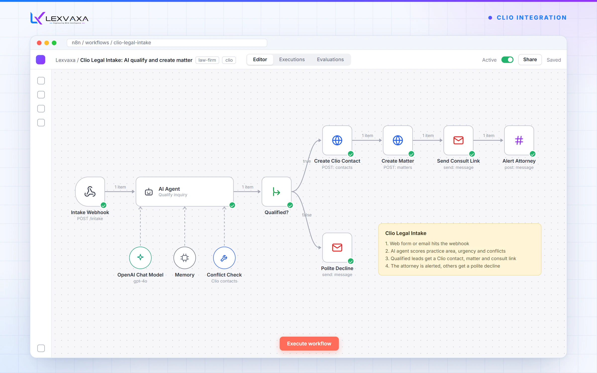

# Clio Legal Intake & Matter Automation

**An AI agent qualifies every new inquiry, checks conflicts and opens the contact and matter in Clio with no manual data entry.**

       

## Overview

New client inquiries from web forms and email had to be entered into Clio by hand, which slowed intake. Lexvaxa built a custom Python service on the Clio API, orchestrated with n8n. An AI agent qualifies each inquiry and extracts the case details, runs a conflict check against Clio contacts, creates the contact and matter in Clio, assigns tasks and sends a consultation link. The client gets a welcome email and the attorney gets an alert; unqualified inquiries receive a polite decline. Screens shown use sample data, so no client records are exposed.

## The challenge

Manual data entry into Clio delayed responses to new inquiries and left room for errors.

## The solution

A Python Clio API service and an n8n workflow with an OpenAI agent, memory and a conflict check tool that routes qualified leads into Clio automatically.

## Key features

- AI qualification of every inquiry
- Case details extracted from forms and emails
- Conflict check against Clio contacts
- Clio contact and matter created automatically
- Tasks assigned and consultation booked
- Welcome email to the client and alert to the attorney
- Polite decline for unqualified inquiries

## Results

- Intake moves from first contact to an open Clio matter with no manual data entry

## Tech stack

Python · Clio API · n8n · OpenAI · AI Agents · Gmail

## Privacy

Client names and records are confidential. Every screen in this repository uses sample data, and source code that belongs to the client is not published.

## Links

- Case study on Lexvaxa: https://lexvaxa.com/work/clio-legal-intake-automation
- Built by **Ch Muhammad Samiullah** ([GitHub](https://github.com/samiullah156-creator)) at [Lexvaxa](https://lexvaxa.com)
